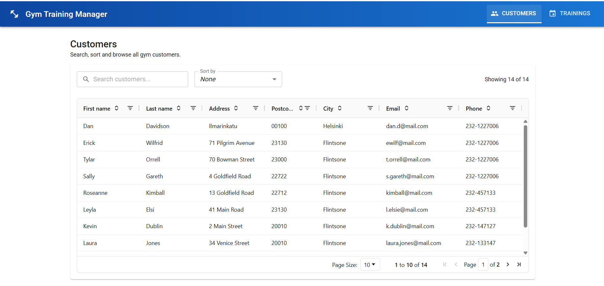
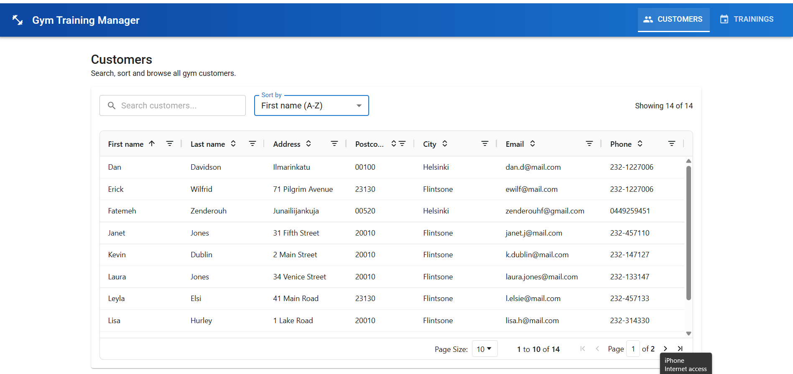
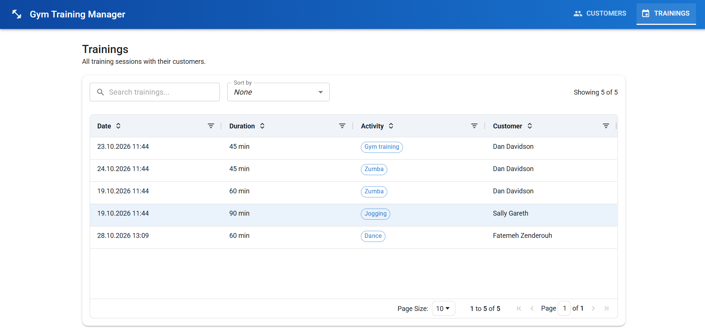
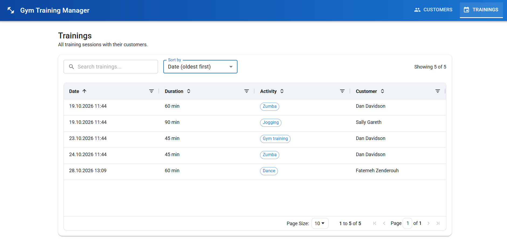

# Gym Training Management System (Frontend)

A React + TypeScript frontend for a personal trainer / gym management system. It shows customers and their training sessions in sortable, searchable tables, with a clean Material UI interface. Data comes from the Personal Trainer REST API.

This project is a course assignment (Front End development, Haaga-Helia University of Applied Sciences) and is built in parts.

## Project status

| Part | Description | Status |
| --- | --- | --- |
| Part 1 | Customer and training list pages, navigation, sorting, searching, date formatting, UI styling | Done |
| Part 2 and later | More features to be added | In progress |

This README describes **Part 1**. It will be updated as new parts are completed.

## Part 1: Requirements

- [x] List pages for customers and trainings
- [x] Navigation between the two list pages
- [x] Sorting on both list pages
- [x] Searching / filtering on both list pages
- [x] Training list shows the customer name
- [x] Training date formatted as `dd.mm.yyyy hh:mm`

## Features

### Navigation
- App bar with icons and links to **Customers** and **Trainings** (React Router)
- The active page is highlighted, and `/` redirects to the customer list

### Customers page
- Table with first name, last name, address, postcode, city, email and phone
- **Sorting:** click a column header (sort arrows are always visible) or use the "Sort by" dropdown
- **Searching:** one search box that filters across all columns, with a clear (X) button
- Per-column filters, pagination and a page size selector (10, 20 or 50 rows)
- "Showing X of Y" result counter

### Trainings page
- Table with date, duration, activity and customer
- **Customer name** (first name + last name) is shown on every training row
- **Date formatting** with Day.js, for example `18.04.2024 18:59`
- Sorting works on the real date value, so dates sort chronologically and not alphabetically
- Search matches the displayed date, activity, duration and customer name
- Activity shown as a chip and duration shown as "N min"
- "Sort by" dropdown and header-click sorting stay in sync

### User experience
- Loading bar while data is being fetched
- Error message with a **Retry** button if the request fails
- Info message when the server returns an empty list
- Responsive layout: the toolbar and table adapt to small screens

## Tech stack

| Purpose | Library |
| --- | --- |
| Framework | React with TypeScript |
| Build tool | Vite |
| Tables, sorting, filtering | AG Grid Community (`ag-grid-react`) |
| UI components and icons | Material UI (`@mui/material`, `@mui/icons-material`, Emotion) |
| Font | Roboto (`@fontsource/roboto`) |
| Date formatting | Day.js |
| Routing / navigation | React Router |
| Styling | Material UI theme + custom CSS (`index.css`) |

## REST API

Base URL: `https://customer-rest-service-frontend-personaltrainer.2.rahtiapp.fi/api`

| Endpoint | Used for |
| --- | --- |
| `GET /customers` | Customer list |
| `GET /gettrainings` | Trainings with their customer information |

API documentation: https://juhahinkula.github.io/personaltrainerdocs/

The `/customers` endpoint wraps its list in `_embedded.customers`, while `/gettrainings` returns a plain array. A small helper (`extractList` in `src/utils.ts`) handles both formats.

## Project structure

```
src/
├── components/
│   ├── CustomerList.tsx   # Customers page
│   ├── TrainingList.tsx   # Trainings page
│   └── ListToolbar.tsx    # Shared search box, sort dropdown and result counter
├── App.tsx                # App bar navigation and routes
├── main.tsx               # Entry point, Material UI theme provider
├── gridTheme.ts           # AG Grid table theme
├── index.css              # Global and responsive styles
├── types.ts               # TypeScript types and API URL
└── utils.ts               # extractList helper
```

## Getting started

Requirements: Node.js 18 or newer.

```bash
# 1. Clone the repository
git clone https://github.com/<your-username>/gym-frontend.git
cd gym-frontend

# 2. Install dependencies
npm install

# 3. Start the development server
npm run dev
```

Open the address shown in the terminal (usually http://localhost:5173).

### Other scripts

```bash
npm run build     # production build
npm run preview   # preview the production build
```

## How it works

- **Data fetching:** each page loads its data with `fetch` inside `useEffect` and stores it in state. Loading and error states are shown on the page.
- **Sorting:** AG Grid's built-in sorting is enabled for all columns, and `unSortIcon` keeps the sort arrows visible. The dropdown uses `applyColumnState` to sort the grid, and `onSortChanged` updates the dropdown when a header is clicked.
- **Searching:** the search box value is passed to AG Grid's `quickFilterText`, which filters rows across all columns.
- **Date formatting:** `valueFormatter` displays the date with Day.js (`DD.MM.YYYY HH:mm`), while the grid keeps the original ISO value for correct sorting.
- **Customer name:** a `valueGetter` combines the customer's first and last name into one column.
- **Shared toolbar:** `ListToolbar` is reused on both pages, so search and sort look and behave the same.

## Screenshots

> Add your screenshots to a `screenshots/` folder and update the file names below if needed.

**Customers page**



**Customers page: sorting and search**



**Trainings page**



**Trainings page: sorting and search**



## Next steps

Features for the next parts of the project will be listed here as they are added.

- [ ] _To be added_

## Author

Dipen Rajbanshi, Business Information Technology, Haaga-Helia University of Applied Sciences
